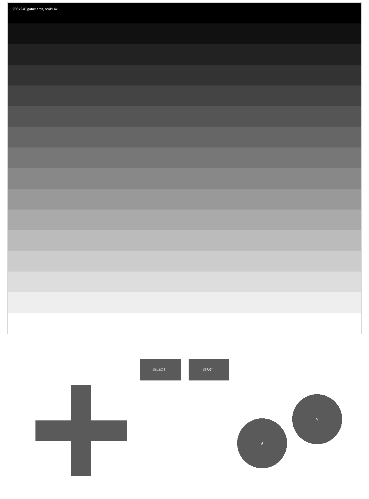

# eink-nes

Kindle Paperwhite 3 上的 NES 模拟器。为墨水屏做的：本地运行、无需联网、虚拟按键在屏幕下半部分。



## 这东西能干什么，不能干什么

**能**：跑 RPG、战棋、棋牌、文字类游戏。触屏操作，不需要额外硬件。

**不能**：跑动作游戏。墨水屏物理刷新率就是 3–8 fps，这不是软件能解决的。玩《魂斗罗》《超级马力欧》手感会很差——但我不会阻止你试。

没有声音。PW3 没有扬声器。

## 安装

前提：Kindle Paperwhite 3（PW3 / 2015 年款），**已越狱**，装了 **KUAL**。

从 [Releases](../../releases) 下载最新的 `eink-nes-pw3.tar.gz`：

```bash
tar xzf eink-nes-pw3.tar.gz -C /mnt/us
```

解压后：

```
/mnt/us/eink-nes                    可执行文件 (ARM 静态, 零依赖)
/mnt/us/extensions/eink-nes/        KUAL 菜单
/mnt/us/roms/                       ROM 放这里
```

然后在 Kindle 上打开 **KUAL → eink-nes → 启动 NES 模拟器**。

## 首次运行建议先 SSH 手动跑

不要一上来就用 KUAL。SSH 进去直接跑能看到实时日志：

```bash
cd /mnt/us
./eink-nes -r /mnt/us/roms roms/test.nes
```

`test.nes` 是自带的测试 ROM（16 条灰度横带 + 水平滚动），用来确认渲染和刷新是否正常。日志在 stderr。

确认屏幕真的在刷、触摸真的响应，再装 KUAL 固化。

## 虚拟按键

```
┌─────────────────────────┐
│                         │
│      游戏画面            │   scale 自动选 (PW3 上是 4x)
│      256x240            │
│                         │
├─────────────────────────┤
│   [SELECT] [START]      │   中间
│                         │
│    ┌─┐                  │
│  ┌─┤ ├─┐        ⓑ  ⓐ    │   方向键在左, AB 在右
│  └─┤ ├─┘                │
│    └─┘                  │
└─────────────────────────┘
```

方向键是十字区，`|dx| <= arm && |dy| <= arm*3` 内判定。A/B 是圆形命中区。

## 命令行参数

```
-f <fb>        framebuffer 设备（默认 /dev/fb0）
-t <event>     触摸设备（默认自动探测 event0-3）
-s <1-5>       缩放倍数（默认按屏幕自动选）
-r <dir>       ROM 目录（可多次指定）
-j <N>         每 N 帧渲染一次（默认 1）
-p <file.ppm>  退出时把屏幕存成 PPM（调试）
-n <帧数>      跑够 N 帧自动退出（调试）
-d             干跑模式：不碰 framebuffer，只验证核心和渲染管线
-b             基准测试模式
-h             帮助
```

**干跑模式 `-d`** 值得一提：它在内存里模拟一块 PW3 尺寸（1072×1448）的 framebuffer，跑完 N 帧后统计游戏区有多少个不同灰度值，少于 3 层就返回 exit 2。CI 用它做冒烟测试，不需要真机也不需要 `/dev/fb0`。

```bash
./eink-nes -d -n 100 roms/test.nes
# [dry] 游戏区灰度层次: 5
# [dry] PASS
```

**关于 `-j`**：默认 1（每帧都刷）。真机上建议开到 **3–5**。墨水屏单次 GC16 刷新要 200–300ms，每帧都刷会把循环卡死。跳帧后模拟继续跑，只是画面更新变慢——反而更省电。

调试环境变量：

```bash
EINK_NES_DEBUG=1 ./eink-nes roms/test.nes    # 打印调色板/直方图/灰度LUT 后退出
```

## 技术实现

### 模拟核心

[QuickNES](https://github.com/kode54/QuickNES_Core)（Nes_Emu 0.7.0）。选它不选 FCEUX 的理由：单仓库、无外部依赖、mapper 覆盖够用、代码量小（36 个源文件参与编译）。FCEUX 太庞大，PW3 那点内存不合适。

核心以 git submodule 引入，未做修改（除了两处配置，见下）。

### 交叉编译

```bash
arm-linux-gnueabihf-g++ -march=armv7-a -mtune=cortex-a9 \
    -mfpu=neon -mfloat-abi=hard -mthumb
```

静态链接。原因：Kindle 固件的 glibc 是 2.12（很老），动态链接大概率跑不起来。

产物验证：

```
ELF 32-bit LSB executable, ARM, EABI5, statically linked, for GNU/Linux 3.2.0
Tag_CPU_arch: v7 / Tag_FP_arch: VFPv3 / Tag_ABI_VFP_args: VFP registers
NEEDED: 0
```

### 对 QuickNES 的两处改动

`blargg_config.h` 有**两份**（`nes_emu/` 和 `fex/`），各自独立生效。两处都要关掉 zlib：

```c
//#define HAVE_ZLIB_H
```

否则链接会报一堆 `undefined reference to gzopen/gzread/gzclose`——交叉编译环境没有 armhf 的 `libz.a`。.nes 本来就是未压缩格式，不需要 gzip 支持。

### 渲染管线

```
NES 8bit 调色板索引 + 调色板 (RGB555, short)
  → 亮度公式: Y = (R*77 + G*150 + B*29) >> 8
  → 4x4 Bayer 有序抖动 (模拟 16 级灰度之间的中间调)
  → framebuffer
```

Bayer 抖动的必要性：eink 是 16 级灰度，NES 的调色板直接量化到 16 级会丢大量细节。抖动后用空间换色阶，画面轮廓清晰得多。

**RGB565 灰度的坑**：G 是 6 bit，R/B 是 5 bit。直接 `(g>>3)<<11 | (g>>2)<<5 | g>>3` 会**偏绿**（实测 `(0,4,0)`）。正确做法：

```c
unsigned int n = (unsigned int)g >> 3;      // 5bit
unsigned short v = (n << 11) | ((n << 1) << 5) | n;
```

### eink 刷新

写完 `/dev/fb0` **不会自动上屏**。必须 ioctl 通知 eink 控制器：

```c
struct kindle_update_data {
    struct kindle_rect update_region;
    uint32_t waveform_mode;   // GC16 / DU / A2
    uint32_t update_mode;     // PARTIAL / FULL
    uint32_t update_marker;
    int      temp;
    /* ... */
};
ioctl(fb_fd, MXCFB_SEND_UPDATE, &ud);
```

波形选择：

| 波形 | 延迟 | 灰阶 | 用途 |
|---|---|---|---|
| GC16 | ~250ms | 16 级 | **本项目的选择** |
| DU | ~100ms | 二值 | 只适合纯黑白 |
| A2 | ~50ms | 二值 | 动画，残影重 |

NES 是彩色转灰度，必须 GC16。DU/A2 会丢灰阶，画面变成黑白剪影。

刷新策略：**局部 GC16 + 每 15 帧全屏 GC16 清残影**。虚拟键是静态的，只在启动时刷一次，不参与每帧刷新。

ioctl 号是**探测式**适配的（PW3 用 `_IOWR('F',46,...)`，K5 用 `_IOWR('F',42,...)`）。探测失败会自动降级成普通 framebuffer 写入，所以在桌面上也能跑（调试用）。

### 布局自适应

按屏幕尺寸从 scale=5 往下试，优先保证虚拟键区高度（≥260px，大屏 ≥380px）：

| 屏幕 | scale | 画面 | 键区高 |
|---|---|---|---|
| 1072×1448 (PW3) | 4 | 1024×960 | 472px |
| 1024×768 (桌面调试) | 2 | 512×480 | 272px |
| 600×800 | 2 | 512×480 | 304px |

## 从源码构建

需要 `arm-linux-gnueabihf-gcc/g++`：

```bash
sudo apt install gcc-arm-linux-gnueabihf g++-arm-linux-gnueabihf

git clone --recursive https://github.com/x1y9/eink-nes.git
cd eink-nes
bash scripts/build_core.sh    # 编译 QuickNES -> build/libqnes.a
bash scripts/build_app.sh     # 编译主程序 -> build/eink-nes
bash scripts/package.sh       # 打包 -> eink-nes-pw3.tar.gz
```

首次 clone 没加 `--recursive` 的话：

```bash
git submodule update --init --recursive
```

### 在 x86 上验证（不需要真机）

**不需要真机，也不需要 framebuffer**：

```bash
sudo apt install qemu-user-static
python3 scripts/make_test_rom.py roms/test.nes
qemu-arm-static ./build/eink-nes -d -n 100 roms/test.nes
```

`-d` 在内存里模拟 PW3 屏幕，跑完自检灰度层次数。这是 CI 用的方式。

如果想看实际画面（需要机器上有可写的 `/dev/fb0`）：

```bash
qemu-arm-static ./build/eink-nes -f /dev/fb0 -n 150 -p /tmp/shot.ppm roms/test.nes
```

## 已知限制

1. **ioctl 号未在真机验证**。PW3 的 `MXCFB_SEND_UPDATE` nr 是 46 还是 42 我靠探测。如果真机上屏幕不刷新，把 `/mnt/us/eink-nes.log` 发出来。
2. **无连发**。"按下即触发"，需要按住连发的游戏要自己加逻辑。
3. **无存档**。QuickNES 支持 snapshot，但没接 UI。
4. **无音频**。PW3 没扬声器；代码里 `set_sample_rate` 调了但没读样本。
5. **ROM 兼容性**。QuickNES 支持常见 mapper（0/1/2/3/4/5/7/9/10/11/19/69/71/79/113/206 等），但不及 FCEUX 全。遇到不支持的计算器会报错。
6. **LGPL 合规**（见下）。

## License

本项目代码（`src/`、`scripts/`、`kual/`）：**MIT**。

模拟核心 [QuickNES](https://github.com/kode54/QuickNES_Core)：**LGPL-2.1**。以 git submodule 引入，未修改其源码（仅改了 `blargg_config.h` 里两处 `#define`）。

**关于 LGPL 静态链接**：LGPL-2.1 第 6 条要求允许用户用修改过的库重新链接。本项目是**静态链接**，严格来说不完全满足——用户无法方便地替换核心。

两种处理方式，你选一种：

- **(A) 现状**：保留静态链接，接受合规风险。Release 里提供 `.o` 文件让有需要的人自己重链。
- **(B) 改动态链接**：`-Wl,-rpath` + 共享库，完全合规，但 Kindle 固件 glibc 2.12 可能跑不起来，收益不确定。

我倾向 (A)，因为目标用户是自己折腾的越狱用户，且 Kindle 环境动态链接风险高。但这是你的仓库，你决定。

ROM 文件不在本仓库内，也不提供下载。自带的 `test.nes` 是脚本生成的，无版权内容。

## 谢绝

不发 ROM。不问「哪里能下 ROM」。测试用 `scripts/make_test_rom.py` 自己生成。
